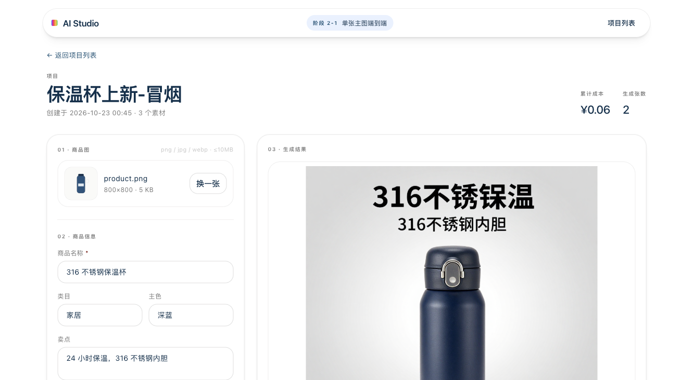
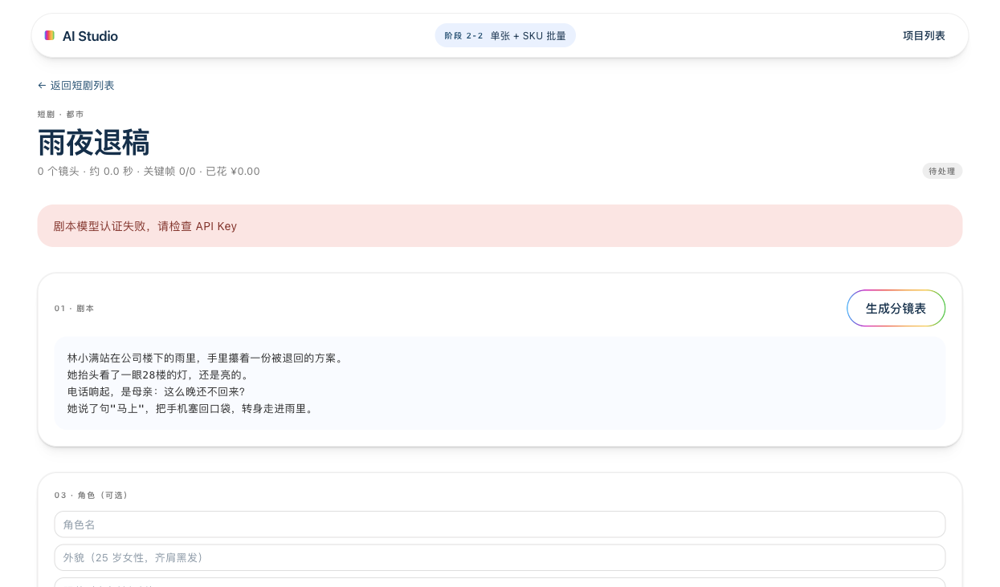

# AI Studio 云端视觉创作工作台

面向图像/视频内容创作者的本地工作台：**电商主图批量生产** + **短剧分镜到轻动效成片**。

用两段式控制成本：先出便宜草稿（¥0.03/张），挑中的再用图生图精修（¥0.30/张）。所有产物带成本记账、质检打分和断点恢复。

<p align="center">
  
</p>

## 能做什么

### 电商线：商品图 → 主图

| 能力 | 说明 |
| --- | --- |
| 单张生成 | 上传商品图 → 填信息 → 生成主图 → 下载 |
| SKU 批量 | 上传 CSV → 试跑确认 → 批量并发（3）→ 进度 → ZIP 导出 |
| 两段式精修 | 草稿 → 图生图精修（保留形状颜色、去掉乱写字） |
| 五维质检 | 符合描述 / 无文字水印 / 商品完整 / 背景干净 / 颜色一致（双图对比） |
| 成本守卫 | 单任务 / 单批次 / 精修三层预算，超限停止并保留已完成 |

### 短剧线：剧本 → 成片

| 能力 | 说明 |
| --- | --- |
| 分镜表 | LLM 把剧本拆成镜头（景别/机位/动作/台词/时长/情绪/连续性），可逐条编辑 |
| 角色 | 角色设定 + 参考图生成 |
| 关键帧 | 逐镜头生成，可单镜头重生成 |
| 轻动效 | 按景别选运镜（远景推近/中景平移/近景推近上移）+ 0.4s 转场，FFmpeg 合成 MP4 |
| 导出 | 分镜表 CSV + 关键帧 + 成片 |

<p align="center">
  
</p>

## 三条必须知道的限制

1. **不是生成式视频**：短剧成片是「关键帧 + 推拉/转场」，商品和人物不会真的动。完整 I2V（¥6-15/分钟）未实现。
2. **角色一致性靠参考图，不是 LoRA**：同一角色的多个镜头不保证完全一致。
3. **当前无声**：未接 TTS。输出视频没有配音。

## 快速开始

```bash
# 依赖：Python 3.12、Node.js 22
cd backend && python3.12 -m venv .venv && ./.venv/bin/pip install -r requirements.txt
cp .env.example .env      # 填 MODEL_T2I_API_KEY
cd ../frontend && npm install

cd .. && ./start.sh       # 后端 :8000 + 前端 :3001
```

打开 <http://127.0.0.1:3001>。

`./start.sh status` 看状态，`./stop.sh` 停止，日志在 `.logs/`。

### 模型配置

所有模型走 [硅基流动](https://cloud.siliconflow.cn)（OpenAI 兼容接口），一个 Key 覆盖四类：

| 用途 | 默认模型 | 单价（估算） |
| --- | --- | --- |
| 草稿出图 | `Tongyi-MAI/Z-Image-Turbo` | ¥0.03/张 |
| 精修（图生图） | `Qwen/Qwen-Image-Edit-2509` | ¥0.30/张 |
| 质检（VLM） | `Qwen/Qwen3-VL-8B-Instruct` | ≈¥0.003/次 |
| 分镜表（LLM） | `deepseek-ai/DeepSeek-V4-Flash` | ≈¥0.02/次 |

换供应商只需改 `.env` 里的 `*_BASE_URL` / `*_NAME`，业务代码不动。

## 目录

```
backend/          FastAPI + SQLAlchemy + SQLite
  app/routers/    projects / assets / generations / batches / dramas
  app/services/   model_client / qa / color_delta / csv_import / batch_runner / storyboard / compose
frontend/         Next.js 16 + React 19 + Tailwind 4
  app/            首页 / 项目详情 / SKU 批量 / 短剧
docs/
  PRD/            PRD v0.2
  手册/           三份通用技术手册
  阶段文档/        各阶段技术开发文档与适配声明
  evidence/       每个阶段的证据包（截图 / 是否表 / verify 输出）
verify.sh         四项自检：mock 测试 / 密钥排除 / 重启恢复 / 前端构建
```

## 工程约束

- **密钥**：只存 `backend/.env`（已 gitignore），不进前端、不进日志、不回显
- **数据可恢复**：SQLite + 本地磁盘，重启后任务状态与产物都在；中断的任务标为可重试
- **错误结构**：统一 `{"error": {"code", "message"}}`，不泄露堆栈
- **SSE 收尾**：任何流式响应都以 `done` / `error` / `cancelled` 结束
- **成本**：金额一律用「分」的整数存储，避免浮点误差

## 自检

```bash
./verify.sh 阶段2-4
```

四项由脚本判定，不看口头申报：

```
mock 测试        通过（122/122 + 前端 29）
前端检查与构建    通过（eslint + tsc + next build）
密钥排除         通过（扫描 git 跟踪文件与构建产物）
重启后数据恢复    通过（写 → 杀进程 → 再起 → 读回）
```

## 许可

MIT
