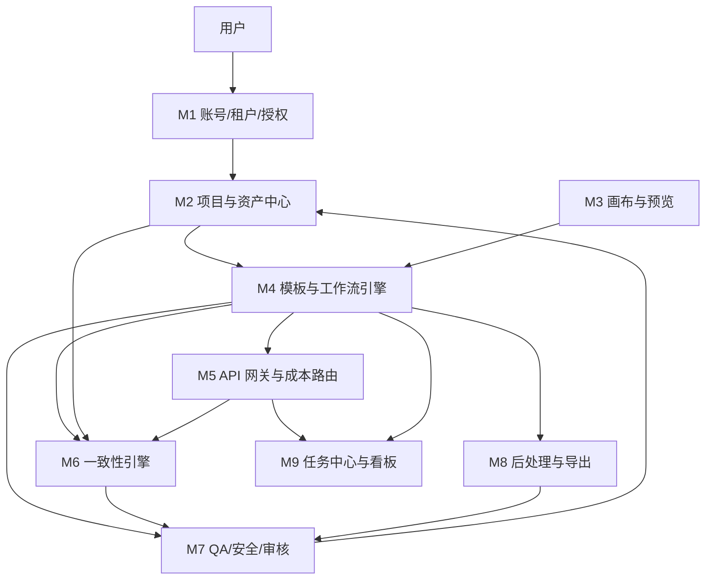

# AI Studio 云端视觉创作工作台 — PRD v0.2

> 文档类型：产品需求文档（PRD）
> 版本：v0.2
> 状态：待评审
> 目标读者：产品、设计、前端、后端、算法/模型、测试、运营
> 关联文档：`产品方案-MVP.md`、`API优先-成本修订-v0.2.md`、`模型选型评估表.md`

## 变更记录

| 版本 | 日期 | 变更 |
|---|---|---|
| v0.1 | 2025-xx | 初版：两条工作流、模块、七层架构草案 |
| v0.2 | 2025-xx | 模型改为云端 API-only；便宜优先；完整 I2V 放 P1；MVP 视频改为“关键帧 + 轻动效”；补充 ¥0.10/张、¥1/min 成本目标与预算守卫 |

---

## 0. 一页纸摘要

**产品：** 面向图像/视频内容创作者的云端视觉创作工作台。

**MVP 两条线：**

1. **电商素材工作流**：商品图 → 主图/场景图 → 批量尺寸/风格 → 多 SKU 一致性 QA → 导出。
2. **短剧工作流**：剧本 → 分镜表 → 角色一致性包 → 关键帧 → 轻动效预览 → 审片导出。

**关键决策：**

- 全部模型推理走 **云端 API**，MVP 不自建 GPU。
- 便宜优先：默认用低价 T2I/LLM/VLM API，精品模型只对付费/主视觉开放。
- **完整 I2V 批量出片不作为 MVP 门槛**，放 P1；MVP 用关键帧 + FFmpeg 轻动效。
- 成本目标：**标准图 ≤¥0.10/张；标准视频 ≤¥1.00/分钟**（轻动效口径）。
- 所有任务必须有 **预算守卫**：超限停止或降档，不允许无限重试烧钱。

---

## 1. 背景与目标

### 1.1 背景

- 目标用户是图像和视频类内容创作者，核心诉求是“更快、更便宜、更一致地批量产出可交付素材”。
- 产品由设备、云端大模型、创作应用三部分协作；**重推理全部在云端**，设备侧只做采集、预览、轻交互。
- 当前创作工具的问题：模型多、参数复杂、批量难、风格/商品/角色容易不一致、最后一公里靠人工。

### 1.2 产品目标

| 目标 | 说明 |
|---|---|
| 降低创作门槛 | 模板化工作流，用户不需要自己拼模型、调参数 |
| 提高批量效率 | 多 SKU、多镜头批量生成、批量 QA、批量导出 |
| 保证一致性 | 商品不串色/不变形；角色不崩脸/不换装 |
| 控制成本 | 低价 API 默认、精品模型按需、预算守卫、缓存、重试上限 |
| 可交付 | 输出满足平台尺寸、品牌规范、安全合规 |

### 1.3 成功指标

| 维度 | 指标 | MVP 目标 |
|---|---|---|
| 电商 | 首版通过率 | ≥70% |
| 电商 | 人工修图率 | ≤30% |
| 电商 | SKU 颜色 ΔE / logo OCR / 形状 DINO | ΔE≤3；logo≥95%；DINO≥0.9 |
| 电商 | 单张图综合成本 | ≤¥0.10 |
| 短剧 | 关键帧采纳率 | ≥70% |
| 短剧 | 角色一致性 ArcFace / DINO | ≥0.85 / ≥0.9 |
| 短剧 | 标准视频成本（轻动效） | ≤¥1.00/分钟 |
| 通用 | 任务成功率 | ≥95%（不含用户主动取消） |
| 通用 | 安全高风险漏放 | 0 |

> 指标需在灰度期校准；若实际不达标，按“降档、提价、换供应商、缩范围”处理，不伪造达标。

### 1.4 非目标（MVP 不做）

- 完整专业 NLE 剪辑器。
- 实时多人协作。
- 自建 GPU 推理集群。
- 模型训练平台 / 自定义 LoRA 训练 UI。
- 素材交易市场。
- 移动端原生 App。
- 全自动整集短剧生成。

---

## 2. 用户与场景

### 2.1 用户角色

| 角色 | 描述 | 核心诉求 |
|---|---|---|
| 电商运营 | 管理店铺商品、上架素材 | 批量、快、平台尺寸正确、SKU 一致 |
| 电商设计 | 做主图/场景图/详情页 | 可控、可改、品牌规范 |
| 短剧制片/导演 | 把控剧本、分镜、成片 | 角色一致、镜头连续、成本可控 |
| 短剧编剧/分镜 | 写剧本、拆分镜 | 快速把文字变成可执行镜头表 |
| 剪辑师 | 审片、剪辑、导出 | 关键帧/片段可编辑、格式标准 |
| 团队管理员 | 管账号、配额、成本 | 权限、用量、预算、审计 |
| 审核员 | 品牌/安全/合规复核 | 问题清单、通过/拒绝、留痕 |

### 2.2 核心用户故事

**电商运营：**
> 作为电商运营，我有一批新 SKU 要上架。我想上传商品图和 SKU 表，选择模板，批量得到主图/场景图，并且颜色、logo、形状不变，这样我不用一张张修图。

**电商设计：**
> 作为设计，我想先跑一个 SKU 看效果，确认后再批量，并且能局部重绘/换背景/改尺寸。

**短剧制片：**
> 作为制片，我想把剧本变成分镜表和关键帧，先审图，再生成轻动效预览，角色从头到尾长得一样，成本可控。

**团队管理员：**
> 作为管理员，我想设置团队配额和单任务预算，超限自动停止或降档，并能看每张图/每分钟视频的成本。

### 2.3 两条 MVP 工作流

| 维度 | 电商素材 | 短剧 |
|---|---|---|
| 输入 | 商品图、SKU 表、品牌规范 | 剧本/故事、角色设定、风格 |
| 核心步骤 | 商品理解 → 标准化 → 模板 → 生成 → 批量变体 → QA → 导出 | 剧本 → 分镜 → 角色包 → 关键帧 → 轻动效 → 审片 → 导出 |
| 一致性对象 | SKU/商品 | 角色/场景/道具 |
| MVP 输出 | 主图、场景图、多尺寸图 | 分镜表、关键帧、1 分钟轻动效预览 |
| 完整 I2V | 不需要 | P1/付费精品 |
| 成本口径 | ≤¥0.10/张 | ≤¥1.00/分钟（轻动效） |

---

## 3. 范围与优先级

### 3.1 P0 / P1 / P2

| 优先级 | 范围 |
|---|---|
| **P0（MVP）** | 账号/租户/RBAC、项目与资产中心、API 网关与成本路由、电商批量工作流、SKU 一致性包、短剧分镜、角色一致性包、关键帧、轻动效预览、QA/安全、导出、预算守卫、任务中心、基础看板 |
| **P1** | 完整 I2V 批量出片、时间线剪辑、人工复核台、更多平台模板、定时批处理、API/SDK 对外开放 |
| **P2** | 多 Agent 并行、MCP 插件、实时协作、自定义模型/LoRA、3D/数字人 |

### 3.2 假设与约束

> 以下为本次 PRD 采用的默认假设，需在评审时确认；确认前不得当成既定事实。

| 项目 | 假设值 |
|---|---|
| 月量（MVP） | 30,000 张图；1,000 分钟标准视频（轻动效） |
| 峰值并发 | 20 个图片任务；3 个视频任务 |
| 图片默认分辨率 | 草稿 768×768；标准 1024×1024；电商导出 800×800 / 750×1000 / 1920×1080 |
| 视频规格 | 1080p、24/30fps、5 秒镜头；轻动效输出 1 分钟 |
| 重试率 | ≤15% |
| 缓存命中 | ≥20% |
| 目标市场 | 中国优先；后续海外 |
| 电商平台 | 淘宝/天猫、京东、抖音电商 |
| 短剧平台 | 抖音、快手、视频号 |
| API 供应商 | 至少 2 家 T2I、1 家 LLM、1 家 VLM、1 家 TTS；视频 P1 至少 2 家 |
| 数据留存 | 资产默认 90 天；审计日志 180 天（可配置） |
| 可用性 | MVP 99.5% |

---

## 4. 产品架构与模块

### 4.1 模块总览

| 模块 | 解决什么问题 | MVP 能力 |
|---|---|---|
| **M1 账号、租户、授权** | 多团队隔离、权限、配额 | 登录、组织/项目、RBAC、配额、API Key |
| **M2 项目与资产中心** | 素材散落、版本混乱、无法复现 | 上传、资产库、标签、版本、血缘、搜索 |
| **M3 画布与预览** | 创作者需要可视化编辑/审片 | 单图编辑、局部重绘、前后对比；关键帧/轻动效预览 |
| **M4 模板与工作流引擎** | 多步骤重复、批量难管理 | 电商/短剧 DAG 模板、变量绑定、批量、重试、续跑 |
| **M5 API 网关与成本路由** | 多供应商、价格/质量/可用性差异 | 统一 API、模型注册、价格表、路由、降级、缓存、计费 |
| **M6 一致性引擎** | SKU 串色、角色崩脸 | 参考包、参考图 API、seed、prompt 模板、评分、重试 |
| **M7 QA、安全与审核** | 品牌/安全/合规、人工成本 | VLM 质检、一致性评分、内容安全、人工复核、审计 |
| **M8 后处理与导出** | 最后一公里靠人工 | 抠图、尺寸/裁剪、文字/logo、水印、平台预设、导出 |
| **M9 任务中心与看板** | 任务不透明、成本不可见 | 队列、进度、失败重试、用量/成本看板 |

### 4.2 模块协作



**一次完整链路：**

1. 用户登录 → 创建项目 → 上传商品图/剧本 → 资产中心生成 `asset_id`。
2. 选择模板 → 工作流引擎实例化 DAG → 任务落库。
3. 每个节点调用 API 网关 → 按价格/质量/可用性路由 → 结果写对象存储。
4. 一致性引擎从资产中心读取参考包，注入参考图/seed/prompt 模板。
5. 后处理 → QA/安全 → 通过则入库/导出；失败则重试或进人工复核。
6. 全链路记录用量、成本、日志；计费按租户统计。

### 4.3 页面/入口

| 页面 | 主要内容 |
|---|---|
| 登录/工作台 | 登录、最近项目、快速开始 |
| 项目列表/详情 | 项目、成员、资产、任务 |
| 资产库 | 上传、筛选、版本、预览、下载 |
| 电商工作流 | 上传 SKU、映射字段、选模板、单 SKU 试跑、批量 |
| 短剧工作流 | 剧本输入、分镜表编辑、角色设置、关键帧、轻动效 |
| 任务中心 | 队列、进度、失败原因、重试/取消 |
| 审核台 | 待审资产、问题清单、通过/拒绝、备注 |
| 用量/成本看板 | 图片张数、视频分钟、成本、预算、供应商 |
| 设置 | 团队、角色、配额、API Key、平台预设 |

---

## 5. 功能需求

> 优先级：P0 = MVP 必须；P1 = 第二期；P2 = 后续。
> 每条需求必须能用“验收标准”验证，不能只写“支持”。

### FR-001 账号、租户与权限（P0）

**描述：** 支持团队/组织、项目、角色和配额；所有数据按租户隔离。

**验收标准：**
- 支持 owner/editor/reviewer/viewer 四种角色；
- 跨租户资产不可见、不可下载；
- 管理员可设置团队月度图片/视频/金额配额；
- 所有导出、审批、配额变更写审计日志。

### FR-002 项目与资产管理（P0）

**描述：** 项目内上传、管理、检索资产，保留版本和生成血缘。

**验收标准：**
- 支持图片/视频/音频/文本上传；
- 每个资产有 `asset_id`、版本、hash、来源、生成参数；
- 支持按项目、类型、标签、时间筛选；
- 支持查看“这张图由哪个模型/seed/参考包生成”；
- 删除资产需二次确认，默认软删除。

### FR-003 API 网关与模型路由（P0）

**描述：** 统一封装多家模型 API，按任务、质量档、价格、可用性路由。

**验收标准：**
- 至少接入 2 家 T2I、1 家 LLM、1 家 VLM、1 家 TTS；
- 支持模型注册表：名称、供应商、能力、单价、区域、状态；
- 支持超时、重试、熔断、备用模型；
- 支持按任务设置最大成本，超限停止或降档；
- 所有调用记录 token/张数/秒数、成本、耗时、错误码。

### FR-004 电商批量工作流（P0）

**描述：** 上传商品图和 SKU 表，选择模板，批量生成主图/场景图/多尺寸图。

**验收标准：**
- 支持 CSV/XLSX 导入 SKU，字段映射可编辑；
- 支持先跑 1 个 SKU 预览，确认后批量；
- 支持主图、场景图、详情图模板；
- 支持批量改尺寸/裁剪/风格；
- 任务失败可单条重试，不重跑已完成项；
- 导出命名符合模板规则。

### FR-005 SKU 一致性包（P0）

**描述：** 为每个 SKU 建立参考包，保证后续生成颜色、形状、logo 一致。

**MVP 能力：**
- 标准商品图（正面/侧面/细节）；
- 颜色配置、logo mask、禁止变化区域；
- prompt 模板、seed 范围；
- 使用支持参考图/多图融合/编辑的 API（如 Kontext、Qwen-Image-Edit、Nano Banana 等）；
- 如供应商支持自定义模型/LoRA，可作为增强项，不作为 MVP 前提。

**验收标准：**
- 同一 SKU 的 3 张场景图，颜色 ΔE≤3；
- logo OCR 识别率≥95%；
- 形状 DINO 相似度≥0.9；
- 低分时能自动重试并给出原因。

### FR-006 短剧分镜拆解（P0）

**描述：** 输入剧本/故事，LLM 输出可编辑的分镜表。

**验收标准：**
- 输入至少支持纯文本、Markdown；
- 输出场次/镜头表：景别、机位、动作、台词、时长、情绪、连续性说明；
- 分镜表可编辑、增删镜头、调整顺序；
- 单集 10–20 个镜头可在 2 分钟内生成初稿（不含人工编辑）。

### FR-007 角色一致性包（P0）

**描述：** 为角色建立多视角参考、描述、声音档案，保证跨镜头一致。

**MVP 能力：**
- 角色圣经：年龄、外貌、发型、服装、性格、说话风格；
- 多视角参考图；
- prompt 模板、seed、参考图 API；
- 如供应商支持角色定制/多图融合，可作为增强项。

**验收标准：**
- 同一角色 5 个镜头，ArcFace 相似度≥0.85；
- DINO 相似度≥0.9；
- 低分镜头能标记并重试；
- 角色设定可复用。

### FR-008 关键帧生成（P0）

**描述：** 按分镜表批量生成关键帧，先审图再动效。

**验收标准：**
- 支持单镜头生成/重生成；
- 支持参考图、构图比例、风格、seed；
- 支持批量生成，失败单条重试；
- 关键帧带镜头 id、参数、评分；
- 关键帧采纳率≥70%。

### FR-009 轻动效预览（P0）

**描述：** 用关键帧 + FFmpeg/2.5D 推拉摇移/视差/转场生成 1 分钟预览，不做完整 I2V。

**验收标准：**
- 支持推、拉、摇、移、视差、淡入淡出、转场；
- 支持 1080p、24/30fps；
- 1 分钟视频 p95 ≤3 分钟生成；
- 成本 ≤¥1.00/分钟（含关键帧、音频、QA、存储）；
- 输出可下载/可进入 P1 时间线。

### FR-010 QA、安全与审核（P0）

**描述：** 自动质检 + 人工复核，保证品牌、安全、合规。

**验收标准：**
- 支持 VLM 质检：指令遵循、商品属性、角色一致性、明显伪影；
- 支持内容安全：NSFW、暴力、未成年人、真实人物、品牌 logo；
- 高风险内容 100% 阻断或转人工；
- 低分资产进入人工复核队列；
- 审核记录可追溯，包含原因、审核人、时间。

### FR-011 后处理与导出（P0）

**描述：** 生成结果满足平台规格和品牌规范。

**验收标准：**
- 支持抠图、裁剪、批量改尺寸、超分（按 API/CPU 能力）；
- 支持文字/logo 叠加、水印；
- 支持淘宝/天猫、京东、抖音电商预设；
- 支持 ZIP 下载、对象存储 URL、Webhook；
- 导出失败可重试，不丢资产。

### FR-012 成本守卫与计费（P0）

**描述：** 每个任务/租户有预算，超限停止或降档，成本可见。

**验收标准：**
- 支持按任务设置最大金额；
- 超限时停止新调用，保留已完成结果；
- 支持降档：精品模型 → 标准模型 → 草稿模型；
- 支持按租户/项目/工作流看成本；
- 账单可按图片张数、视频分钟、LLM token、QA 次数拆分。

### FR-013 任务中心与断点续跑（P0）

**描述：** 批量任务可查看、重试、取消、续跑。

**验收标准：**
- 任务状态：排队/运行/成功/失败/取消/超预算；
- 失败项可单独重试；
- 断点续跑不重复调用已完成项；
- 任务事件可通过 WebSocket/轮询获取。

### FR-014 模板管理（P0）

**描述：** 电商/短剧模板可配置、可版本化。

**验收标准：**
- 模板包含：输入 schema、DAG、默认模型、价格上限、QA 规则；
- 模板可复制、停用、版本化；
- 模板变更不影响已运行任务。

### FR-015 用量与成本看板（P0）

**描述：** 管理员和运营能看到成本、成功率、供应商表现。

**验收标准：**
- 展示图片张数、视频分钟、token、成本、预算余量；
- 展示供应商成功率、p95 时延、错误码；
- 支持按天/周/月、项目、模型筛选；
- 成本异常（超预算/单价变化）告警。

### FR-016 通知与协作（P1）

**描述：** 任务完成、审核、预算告警通知。

**验收标准：**
- 支持站内信、邮件、Webhook；
- 审核任务可指派；
- 通知可配置开关。

### FR-017 完整 I2V 批量出片（P1）

**描述：** 在关键帧通过后，调用视频 API 生成镜头，进入时间线。

**验收标准：**
- 支持至少 2 家视频 API；
- 支持 5 秒镜头、首尾帧（如供应商支持）；
- 失败可重试/换供应商；
- 成本单独核算，不纳入 ¥1/min 标准档；
- 只对付费/精品档开放。

### FR-018 时间线剪辑（P1）

**描述：** 将镜头、音频、字幕组装成片。

**验收标准：**
- 支持剪切、排序、转场、字幕、音量；
- 支持导入关键帧/视频片段/音频；
- 支持导出 MP4。

---

## 6. 工作流详细需求

### 6.1 电商素材工作流

**入口：** 项目 → 新建 → 电商素材。

**步骤：**

1. **上传**：商品图、SKU 表（CSV/XLSX）、品牌规范。
2. **字段映射**：SKU 编码、颜色、材质、尺寸、卖点、平台类目。
3. **商品理解**：VLM 提取属性；抠图/去背景。
4. **标准化**：裁切、居中、色彩校正、打光归一。
5. **模板选择**：主图、场景图、详情图；平台尺寸。
6. **单 SKU 试跑**：生成 1 组图，人工确认。
7. **批量执行**：按 SKU fan-out；失败单条重试。
8. **一致性/合规 QA**：颜色、logo、形状、属性、安全。
9. **人工复核**：低分/高风险进入审核台。
10. **导出**：平台预设、命名、水印、ZIP/URL/Webhook。

**异常处理：**
- SKU 表字段缺失 → 标记待确认，不阻断其他 SKU；
- 商品图模糊/多主体 → 提示重拍或手动框选；
- API 超时/涨价 → 切备用供应商或降档；
- 超预算 → 停止并保留已完成结果。

### 6.2 短剧工作流

**入口：** 项目 → 新建 → 短剧。

**步骤：**

1. **剧本输入**：故事梗概、角色、集数、风格、平台规格。
2. **分镜拆解**：LLM 生成场次/镜头表。
3. **分镜编辑**：增删镜头、调整顺序、补充台词/动作。
4. **角色设置**：角色圣经、多视角参考图、声音档案。
5. **关键帧生成**：逐镜头生成，支持参考图/seed/比例。
6. **关键帧审核**：通过/重生成/标记问题。
7. **轻动效预览**：按镜头生成推拉摇移/视差/转场，合成 1 分钟预览。
8. **QA/安全**：角色一致性、画面安全、品牌合规。
9. **导出**：MP4、关键帧包、分镜表、字幕。

**异常处理：**
- 角色一致性低 → 增加参考图/调整 prompt/重生成；
- 关键帧不通过 → 单镜头重试，不重跑全片；
- 视频 API 超预算 → 降级为轻动效；
- 剧本过长 → 按场次拆分，分批生成。

---

## 7. 模型与 API 策略

### 7.1 API-only 原则

- MVP **不自建 GPU 推理**；全部生成/理解/语音走云端 API。
- 至少接 2 家 T2I、1 家 LLM、1 家 VLM、1 家 TTS；P1 视频至少 2 家。
- 所有 API 通过统一网关，业务代码不直接绑死供应商。
- 供应商必须支持：按量计费、明确单价、超时/错误码、内容安全策略、数据使用条款。

### 7.2 默认模型路由

| 任务 | 默认（便宜） | 升级（精品） | 备注 |
|---|---|---|---|
| 分镜/剧本拆解 | DeepSeek-V3.1、Qwen-Flash、GLM-Flash | Claude/GPT | 便宜模型足够 |
| 文生图 | FLUX.1 schnell API、SDXL-Lightning API、Qwen-Image API | Seedream、GPT-Image、Imagen | 默认 768–1024、4–8 步 |
| 图像编辑 | Qwen-Image-Edit API、FLUX Kontext API | Nano Banana | 参考图/局部重绘 |
| 视觉 QA | Qwen2.5-VL-7B/32B API | GPT-4o/Gemini | 普通图抽检，主图全检 |
| 视频 | 关键帧 + FFmpeg 轻动效 | Wan2.2 API、LTX-Video API | MVP 不做完整 I2V |
| 精品视频 | — | Kling 2.5、Seedance、Veo 3 | P1/付费档 |
| 语音 | CosyVoice API、Edge TTS | ElevenLabs | 对白/旁白 |
| 安全 | 云内容安全 API + Qwen3Guard API | — | 按量 |

### 7.3 成本守卫规则

| 规则 | 行为 |
|---|---|
| 单张图成本 > ¥0.10 | 停止使用该模型，降档或换供应商 |
| 标准视频成本 > ¥1.00/分钟 | 降级为轻动效/低分辨率/减少镜头 |
| 单任务超预算 | 停止新调用，保留已完成结果 |
| 单租户超月配额 | 停止新任务，提示升级套餐 |
| 重试次数 > 2 | 转人工或降档，不无限重试 |
| 供应商单价上涨 > 20% | 自动切备用供应商并告警 |

### 7.4 降级顺序

```text
精品模型 → 标准模型 → 草稿模型 → 轻动效/静态关键帧 → 人工
```

任何降级都必须记录原因，并在结果中标注“降级产出”。

---

## 8. 非功能需求

### 8.1 性能

| 项目 | 目标 |
|---|---|
| 单张图 p95 | ≤45 秒 |
| 单镜头关键帧 p95 | ≤60 秒 |
| 1 分钟轻动效视频 p95 | ≤3 分钟 |
| 100 张批量任务 p95 | ≤10 分钟（20 并发） |
| 页面首屏 | ≤2 秒 |
| 任务状态刷新 | ≤3 秒 |

### 8.2 可用性与容量

- MVP 可用性 99.5%；
- 支持 20 个图片任务、3 个视频任务并发；
- 队列积压时显示预计等待时间；
- 供应商故障自动切换，切换失败转人工。

### 8.3 安全与合规

- 租户数据隔离；对象存储签名 URL；数据库行级隔离。
- 内容安全：生成前 prompt 检查、生成后图像/视频检查；高风险转人工。
- 真实人物/未成年人/品牌 logo：授权检查与拦截策略。
- 水印：可见水印 + 不可见水印 + C2PA（可用时）。
- 审计：生成、导出、审批、模型切换、配额变更全部留痕。
- 数据留存：默认 90 天，可配置；默认不用客户数据训练。
- 模型/API license：记录商用限制、区域、数据条款；不合规供应商禁用。

### 8.4 可观测性

- 日志：请求、响应、错误码、耗时、成本。
- 指标：成功率、p50/p95、重试率、缓存命中、成本、QA 通过率。
- 轨迹：`run_id → job_id → model → params_hash → seed → asset_id → qa_score → export`。
- 告警：超预算、供应商错误率、成本异常、审核积压。

---

## 9. 数据与接口

### 9.1 核心实体

| 实体 | 关键字段 |
|---|---|
| `Tenant` | id、name、plan、quota、region |
| `User` | id、tenant_id、role |
| `Project` | id、tenant_id、name、type |
| `Asset` | id、project_id、type、uri、hash、version、parent_id、metadata |
| `ReferencePack` | id、type、refs、prompt_template、seed_range、color_profile、masks |
| `WorkflowTemplate` | id、type、dag、variables、version |
| `WorkflowRun` | id、template_id、status、input、output、cost |
| `Job` | id、run_id、node_id、model、provider、params、seed、status、error、cost |
| `QAReport` | id、asset_id、scores、issues、reviewer、status |
| `PriceRule` | id、provider、model、unit、price、currency、effective_at |
| `UsageRecord` | id、tenant_id、job_id、unit、amount、cost |
| `AuditEvent` | id、tenant_id、actor、action、resource、result、ts |

### 9.2 关键 API

| API | 作用 |
|---|---|
| `POST /v1/projects` | 创建项目 |
| `POST /v1/assets` | 上传资产 |
| `POST /v1/reference-packs` | 创建一致性包 |
| `POST /v1/workflows/{id}/runs` | 启动工作流 |
| `GET /v1/runs/{id}` | 运行状态 |
| `GET /v1/jobs/{id}` | 任务详情 |
| `POST /v1/jobs/{id}/retry` | 重试 |
| `POST /v1/qa/check` | 质检 |
| `POST /v1/exports` | 导出 |
| `GET /v1/usage` | 用量/成本 |
| `GET /v1/models` | 模型/价格 |
| `WS /v1/runs/{id}/events` | 实时事件 |

### 9.3 事件示例

```json
{
  "event_id": "evt_...",
  "tenant_id": "t_...",
  "run_id": "run_...",
  "job_id": "job_...",
  "type": "job.succeeded",
  "asset_id": "asset_...",
  "provider": "vendor-a",
  "model": "flux-schnell",
  "params_hash": "sha256:...",
  "seed": 123456,
  "status": "succeeded",
  "cost": {"unit": "image", "amount": 0.062, "currency": "CNY"},
  "qa": {"consistency": 0.91, "safety": "pass"},
  "ts": "2025-xx-xxTxx:xx:xxZ"
}
```

---

## 10. 埋点与指标

| 事件 | 用途 |
|---|---|
| `project_created` | 项目转化 |
| `asset_uploaded` | 素材规模 |
| `workflow_started` | 工作流使用 |
| `job_succeeded` / `job_failed` | 成功率、失败原因 |
| `job_retried` | 重试成本 |
| `qa_passed` / `qa_failed` | 质量 |
| `review_approved` / `review_rejected` | 人工复核 |
| `export_completed` | 交付 |
| `budget_exceeded` | 成本守卫 |
| `model_fallback` | 供应商稳定性 |

**核心看板：**
- 成本：图片张数/成本、视频分钟/成本、按项目/供应商拆分；
- 质量：QA 通过率、人工修图率、关键帧采纳率；
- 效率：p50/p95、队列时长、重试率；
- 业务：首版通过率、交付时长、留存。

---

## 11. 验收与测试

### 11.1 E2E 验收

**电商：**
- 10 个 SKU × 3 个模板批量跑通；
- 单张图平均成本 ≤¥0.10；
- 首版通过率 ≥70%；
- 颜色 ΔE≤3，logo OCR≥95%；
- 导出尺寸符合淘宝/京东/抖音预设。

**短剧：**
- 1 集 10–20 个镜头：剧本 → 分镜 → 关键帧 → 1 分钟轻动效；
- 角色 ArcFace≥0.85；
- 关键帧采纳率≥70%；
- 标准视频成本 ≤¥1.00/分钟；
- 关键帧/预览可导出。

### 11.2 失败与降级测试

- 主供应商超时 → 切备用；
- 主供应商涨价 → 降档/切换；
- 超预算 → 停止并保留结果；
- 内容安全拦截 → 阻断 + 人工复核；
- 任务中断 → 断点续跑不重复扣费。

### 11.3 成本回归

- 每次模型/价格变更跑 100 张图 + 10 分钟视频；
- 记录平均成本、p95 时延、QA 通过率；
- 超过目标 10% 触发告警。

---

## 12. 里程碑

| 阶段 | 周期 | 交付 |
|---|---|---|
| Phase 0 | 2 周 | 账号/租户、资产中心、API 网关、单图生成/编辑 |
| Phase 1 | 2–3 周 | 电商批量工作流、SKU 一致性包、QA、导出 |
| Phase 2 | 2–3 周 | 短剧分镜、角色包、关键帧、轻动效预览 |
| Phase 3 | 2 周 | 成本看板、预算守卫、审核台、灰度 |
| P1 | 后续 | 完整 I2V、时间线、更多平台、API/SDK |

> 周期为建议值，按团队规模和供应商接入速度调整。

---

## 13. 风险与待确认

| 风险 | 影响 | 应对 |
|---|---|---|
| ¥1/min 完整 I2V 不可行 | 成本超支 | MVP 用轻动效；完整 I2V 放 P1/提价 |
| API 供应商涨价/限流 | 成本/稳定性 | 多供应商、价格表、自动切换 |
| API 不支持参考图/LoRA | 一致性不达标 | 选支持参考图/多图融合的供应商；降低一致性承诺 |
| 商品/角色一致性评分不稳定 | 返工 | 先单 SKU/单镜头试跑；人工复核 |
| 数据合规/真实人物 | 法律风险 | 授权、审核、水印、区域限制 |
| 用户预期“全自动” | 体验落差 | 明确“AI 初稿 + 人工审核”的定位 |
| 供应商锁定 | 迁移成本 | 统一网关、标准数据契约、可替换 |

**待确认：**
1. ¥0.10/张、¥1/min 是成本目标还是对外售价？
2. 月量、峰值并发、目标区域。
3. 视频质量底线：720p/1080p？能否接受轻动效作为 MVP？
4. 可接受的 API 供应商名单与商务价格。
5. 品牌安全/人工复核比例。
6. 是否需要对外 API/SDK。

---

## 14. 附录

### 14.1 术语

| 术语 | 含义 |
|---|---|
| API-only | 全部模型推理走云端 API，不自建 GPU |
| 轻动效 | 关键帧 + 推拉摇移/视差/转场，不是生成式视频 |
| 一致性包 | 参考图、prompt 模板、seed、颜色/logo 约束的集合 |
| 预算守卫 | 按任务/租户限制成本，超限停止或降档 |
| 降档 | 精品 → 标准 → 草稿 → 轻动效/人工 |
| QA | 质量与安全自动检查 |
| 首版通过率 | 第一次生成即可用、无需重生成的比例 |

### 14.2 成本口径

- 图片成本 = API 单价 × (1+重试率) × (1-缓存命中) + QA + 存储；
- 标准视频成本 = 关键帧图片成本 + 渲染 + 音频 + QA + 存储；
- 完整 I2V 成本 = 视频 API 单价 × 镜头数 × (1+重试率) + 音频 + QA + 存储；
- 所有成本按租户/项目/工作流归集。

### 14.3 关联文件

- `API优先-成本修订-v0.2.md`：成本可行性详细测算；
- `API成本测算.py`：可运行的成本测算脚本；
- `产品方案-MVP.md`：模块、架构、工作流背景；
- `模型选型评估表.md`：模型矩阵与评分。
