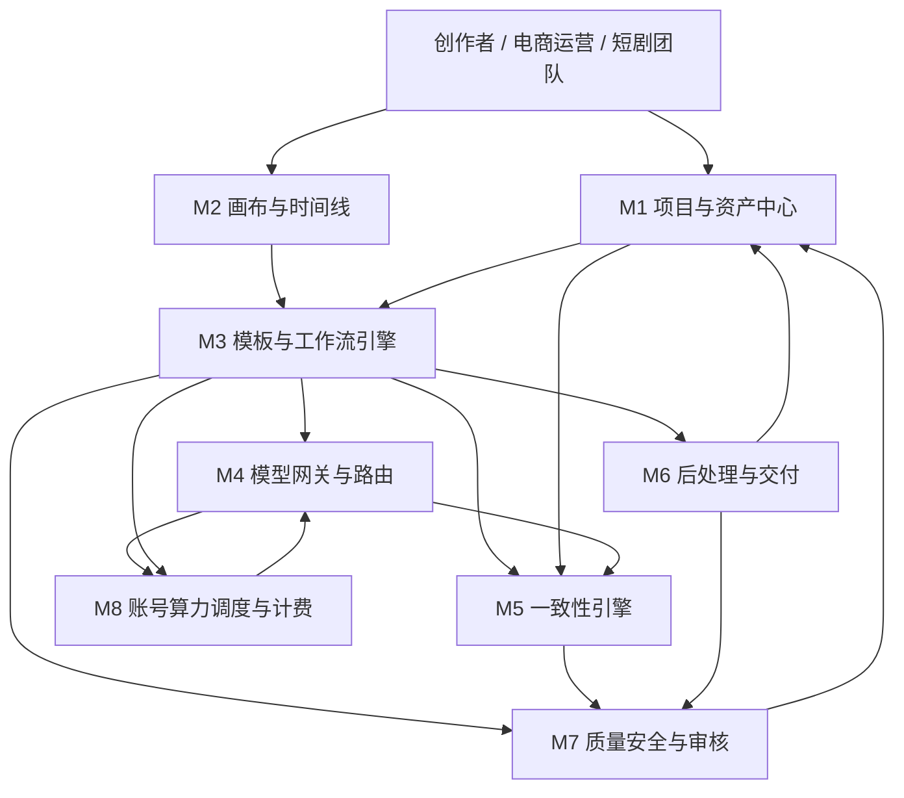
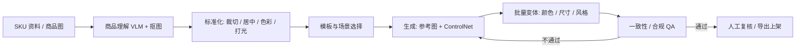
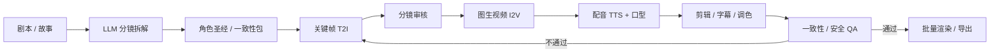

# AI Studio 云端视觉创作工作台 — MVP 产品方案

> 版本：v0.1（待确认）
> 状态：Step 1–4 方案草案，未进入 Step 5 代码生成
> 依据：`BLUEPRINT.md` 五步 SOP；引擎草案见同目录 `方案.md`
> 配套：`模型选型评估表.md`、`模型评分矩阵.csv`
>
> **v0.2 修订**：模型部署策略已改为“接云端 API、便宜优先；完整 I2V 放 P1；MVP 用关键帧 + 轻动效”。以 `API优先-成本修订-v0.2.md` 为准。

---

## 0. 前提与假设

1. “设备”理解为用户侧终端（PC / 平板 / 拍摄设备 / 云工作站入口），负责采集、预览和轻交互；**重推理全部在云端**。
2. 产品同时面向国内与海外创作者；具体区域、数据出境、模型 license 需在立项时确认。
3. MVP 以 **Web 工作台**为主，设备端只做上传、预览、参数调整和任务查看。
4. 目标是先跑通两条可交付工作流，不追求一次性做成全能创作平台。

---

## 1. 产品定位

### 1.1 一句话

**面向图像和视频内容创作者的云端视觉创作工作台：在画布上生成、编辑、组合素材，用模板化工作流把商品图和短剧从“想法”批量变成“可交付成片”。**

### 1.2 产品目标

| 目标 | 说明 |
|---|---|
| 降低创作门槛 | 创作者不用自己拼模型、调参数、写复杂 prompt |
| 提高批量效率 | 电商多 SKU、短剧多镜头可批量生成、批量质检、批量导出 |
| 保证一致性 | 商品不串色/不变形，角色不崩脸/不换装 |
| 控制成本 | 草稿/标准/精品三档模型路由，避免所有任务都走最贵模型 |
| 可交付 | 输出直接满足平台尺寸、品牌规范、安全合规要求 |

### 1.3 非目标（MVP 不做）

- 不做完整专业 NLE（Premiere / DaVinci 级剪辑器）。
- 不做实时多人协同编辑。
- 不做模型训练平台和自定义 LoRA 训练 UI。
- 不做素材交易市场。
- 不做移动端原生 App。
- 不做复杂 3D / 数字人直播。

### 1.4 成功指标

| 维度 | 指标 | MVP 建议目标 |
|---|---|---|
| 电商 | 首版通过率 | ≥70% |
| 电商 | 人工修图率 | ≤30% |
| 电商 | SKU 一致性（颜色 ΔE / logo OCR / 形状 DINO） | ΔE≤3，logo≥95%，DINO≥0.9 |
| 电商 | 单 SKU 综合成本 | 比人工/现有方案下降 ≥30% |
| 短剧 | 关键帧采纳率 | ≥70% |
| 短剧 | 角色一致性（ArcFace / DINO） | ArcFace≥0.85，DINO≥0.9 |
| 短剧 | 单分钟成片成本 | 比现有方案下降 ≥30% |
| 通用 | p95 任务时延 | 按套餐/SLA 定义 |
| 通用 | 安全合规拦截准确率 | 高风险内容 100% 拦截或转人工 |

> 以上为建议目标，需根据业务基线校准。

---

## 2. 用户与场景

### 2.1 目标用户

| 场景 | 用户 | 核心任务 | 主要痛点 |
|---|---|---|---|
| 电商素材 | 电商运营、店铺设计、代运营、品牌视觉 | 商品图、主图、场景图、批量改尺寸/风格、多 SKU 一致性 | 重复劳动多、SKU 串色/变形、平台规格多、返工高 |
| 批量短剧 | 制片、导演、编剧、剪辑、短剧工作室 | 分镜脚本、文生图/视频、角色一致性、批量出片 | 角色崩、镜头不连、生成成本高、周期长 |

### 2.2 用户任务（JTBD）

**电商运营：**
> 当我有一批新 SKU 要上架时，我想上传商品图和 SKU 表，选择模板后批量得到符合平台规格的主图/场景图，并且颜色、logo、形状不变，这样我不用一张张修图。

**短剧制片：**
> 当我有一个短剧剧本时，我想让系统拆成分镜、生成关键帧和视频片段，角色从头到尾长得一样，并且能批量出片，这样我能在预算内快速做出可审片的版本。

### 2.3 两条工作流的共性与差异

| 维度 | 电商素材 | 批量短剧 |
|---|---|---|
| 一致性对象 | SKU / 商品 | 角色 / 场景 / 道具 |
| 主要输出 | 静态图（主图、场景图、详情图） | 视频片段 + 成片 |
| 核心风险 | 串色、变形、logo 错、平台拒审 | 角色崩、镜头不连、口型不对、内容不安全 |
| 批量单位 | 一个 SKU = 一组图 | 一场戏 = 一组镜头 |
| 质量门 | 商品属性 + 品牌规范 | 角色身份 + 时序连续 + 安全合规 |
| 共同底座 | 资产中心、模型网关、工作流引擎、一致性引擎、QA、导出 | 同左 |

---

## 3. MVP 范围

### 3.1 优先级

| 优先级 | 内容 |
|---|---|
| **P0（MVP 必须）** | 账号/租户/配额、项目与资产中心、模型网关、工作流引擎、一致性引擎、QA/安全、导出、电商素材模板、短剧分镜到关键帧 |
| **P1** | 时间线剪辑、完整 I2V 批量出片、人工复核台、定时批处理、更多平台模板 |
| **P2** | 多 Agent 并行、MCP 插件市场、实时多人协作、自定义 LoRA 训练 UI、3D/更多模态 |

### 3.2 MVP 边界

**做：**
- 单图生成、局部重绘、扩图、背景替换。
- 电商：商品图 → 主图/场景图 → 批量尺寸/风格 → 一致性 QA → 导出。
- 短剧：剧本 → 分镜表 → 角色参考包 → 关键帧 → 关键帧审核 → 首批 I2V 镜头。
- 资产版本、生成参数、seed、模型版本可追溯。
- 失败重试、断点续跑、人工接管。

**不做：**
- 完整剪辑时间线（P1 再做）。
- 全自动整集短剧（P1/P2 逐步放开）。
- 实时协作、素材市场、模型训练平台。

---

## 4. 核心模块

MVP 由 **6 个用户可感知模块 + 2 个平台底座模块** 组成。

### 4.1 模块清单

| 模块 | 解决什么问题 | MVP 能力 | 输入 | 输出 | 依赖 |
|---|---|---|---|---|---|
| **M1 项目与资产中心** | 素材散落、版本混乱、无法复现 | 项目空间、上传、资产库、标签、SKU/角色圣经、版本与血缘、以图搜图 | 文件、URL、SKU 表、剧本 | asset_id、版本、元数据、参考包 | 对象存储、Postgres、向量库 |
| **M2 画布与时间线** | 创作者需要可视化生成、编辑、组合 | 图层/节点画布、prompt 面板、局部重绘/扩图、前后对比、撤销；视频时间线、剪切、字幕 | 资产、prompt、参数 | 编辑后的资产、时间线工程 | M1、M3、M4 |
| **M3 模板与工作流引擎** | 多步骤任务重复、批量难管理、失败难续跑 | 电商/短剧两套 DAG 模板、变量绑定、批量 fan-out、重试与断点续跑、定时任务 | 模板、变量、资产 | WorkflowRun、Job、事件 | M4、M5、M6、M7 |
| **M4 模型网关与路由** | 模型多、API 不统一、成本/质量/时延难平衡 | 统一 API、模型注册表、任务路由、异步任务、失败降级、成本计量、安全钩子 | 任务类型、prompt、参考包、参数 | 生成结果、usage、错误 | 模型服务、GPU 池 |
| **M5 一致性引擎** | 多 SKU 串色、角色换脸、风格漂移 | 参考图包、商品/角色 LoRA、IP-Adapter/InstantID、ControlNet、seed 锁定、颜色配置、一致性评分、自动重试 | 参考包、生成结果 | 控制条件、评分、重试建议 | M1、M4、M7 |
| **M6 后处理与交付** | 生成图不能直接上架/出片，最后一公里靠人工 | 抠图、批量改尺寸/裁剪、超分、重新打光、文字/logo 排版、水印、平台规格预设、导出到 S3/CDN/API | 生成资产、平台规格 | 可交付资产、导出 URL | M1、M4 |
| **M7 质量、安全与审核** | 品牌不合规、内容不安全、人工审核成本高 | VLM 自动质检、一致性检查、NSFW/品牌/logo 检查、人工复核队列、审计日志、水印 | 资产、规则、参考包 | 评分、问题清单、通过/拒绝 | M1、M5、M6 |
| **M8 账号、算力调度与计费** | 多租户隔离、GPU 利用率、配额和成本 | 登录/组织/角色、RBAC、配额、GPU 池、队列、优先级、自动扩缩、用量计费 | tenant、任务、套餐 | 授权结果、调度结果、账单 | K8s、GPU 池、计费系统 |

### 4.2 模块协作关系



**一句话协作链路：**

> 用户从 M1 取资产、在 M2 创作或选 M3 模板；M3 编排 M4 生成、M5 一致性控制、M6 后处理、M7 质检；M8 负责租户、配额和 GPU 调度；所有结果回到 M1 形成新版本。

### 4.3 按项目规则的组件选型

| 组件 | MVP | 理由 |
|---|---|---|
| `s01` Agent Loop | 必选 | 生成/编辑/重试的基础循环 |
| `s02` 工具系统 | 必选 | 模型、存储、导出、平台 API 都是工具 |
| `s03` 权限系统 | 必选 | 租户隔离、品牌审核、导出审批、默认拒绝 |
| `s04` Hook 系统 | 必选 | 审计、水印、安全拦截、埋点 |
| `s05` 任务规划 | 必选 | 多步骤工作流需要计划与进度 |
| `s07` 技能加载 | 必选 | 风格模板、品牌规范、平台规则按需加载 |
| `s10` 任务系统 | 必选 | 批量任务持久化、依赖、断点续跑 |
| `s11` 后台任务 | 必选 | 视频渲染、批量出图异步执行 |
| `s15` 集成 Harness | 必选 | 多机制归一到单一循环 |
| `s16` 工作流运行时 | 必选 | 电商/短剧是固定编排，适合写进工作流 |
| `s17` 目标闭环 | 必选 | QA 自动判断“是否可交付”，失败交还人工 |
| `s06` 子 Agent | 二期 | 多镜头并行探索 |
| `s08` 上下文压缩 | 二期 | 长剧本、长会话 |
| `s09` 记忆系统 | 二期 | 品牌偏好、角色设定跨会话复用 |
| `s12` 定时调度 | 二期 | 夜间批量任务 |
| `s13` Agent 团队 | 二期 | 多镜头/多 SKU 并行隔离 |
| `s14` MCP 插件 | 二期 | 外部工具生态 |

---

## 5. Agent 编排设计

### 5.1 系统提示词草案

```text
你是 AI Studio 的创作编排 Agent，负责把用户的创作目标拆成可执行的工作流，
并调用工具完成生成、编辑、质检和交付。

身份与边界：
- 你服务图像/视频内容创作者，不替代用户的品牌、版权与合规责任。
- 不编造商品属性、角色设定、平台规则；缺失信息必须询问或标记“待确认”。
- 不执行未授权的删除、覆盖、外发、支付、退款操作。
- 涉及真实人物、未成年人、品牌 logo、版权素材时，必须走授权/审核检查。
- 生成内容必须通过安全与品牌规范检查后，才能导出或发布。

工作方式：
1. 先确认目标、交付物、平台规格、参考资产、禁止项。
2. 选择模板：电商素材 / 短剧分镜；没有合适模板时，先给出计划再执行。
3. 每次生成前锁定参考包（SKU/角色）、seed、模型版本、控制条件。
4. 生成后自动质检；不通过时说明原因并重试，最多 N 次；仍失败则交人工。
5. 交付时给出资产清单、版本、评分、待确认项。

工具：ingest_asset、understand_asset、generate_image、edit_image、
generate_video、synthesize_speech、qa_check、export_asset、request_approval。

知识目录：
- 平台规格与审核规则
- 品牌视觉规范
- 电商场景模板
- 短剧分镜与角色设定规范
- 安全与合规红线
```

### 5.2 工具清单

| 工具 | 输入 | 输出 | 副作用 | 权限 | 归属层 |
|---|---|---|---|---|---|
| `ingest_asset` | 文件/URL、项目 id | asset_id、元数据 | 写对象存储 | allow | ⑤ |
| `understand_asset` | asset_id、问题 | 属性、caption、标签 | 无 | allow | ④ |
| `generate_image` | prompt、参考包、参数 | 图片资产 | GPU 成本、写存储 | allow（超额 ask） | ④ |
| `edit_image` | asset_id、mask、指令 | 新图片资产 | 写存储 | allow | ④ |
| `generate_video` | 关键帧、prompt、时长 | 视频资产 | GPU 成本、写存储 | ask | ④ |
| `synthesize_speech` | 文本、音色 | 音频资产 | 写存储 | allow | ④ |
| `qa_check` | asset_id、规则集 | 评分、问题清单 | 无 | allow | ③ |
| `export_asset` | asset_id、平台规格 | 导出 URL | 外部写入 | ask | ⑤ |
| `request_approval` | job_id、原因 | 审批结果 | 无 | ask | ③ |
| `log_event` | 事件 | ack | 追加审计日志 | allow | ⑥ |

### 5.3 失败与降级策略

| 场景 | 处理 |
|---|---|
| 模型超时 | 指数退避重试；仍失败切备用模型 |
| 模型返回质量差 | 自动加约束重试；连续 N 次失败转人工 |
| 一致性评分低 | 回退到参考图 + 更强 ControlNet；或降低风格强度 |
| GPU 不足 | 任务排队；高优先级租户插队；可降级到草稿模型 |
| 安全拦截 | 阻断并说明原因；高风险转人工审核 |
| 外部平台 API 失败 | 重试 + 死信队列；导出失败不丢失资产 |
| 预算超限 | 停止新任务，保留断点，提示用户 |

---

## 6. 场景 A：电商素材工作流

### 6.1 流程



### 6.2 阶段说明

| 阶段 | 做什么 | 关键模块 | 产物 |
|---|---|---|---|
| S1 SKU 接入 | 上传商品图、SKU 表、品牌规范 | M1 | SKU 记录、原始资产 |
| S2 商品理解 | VLM 提取品类、属性、卖点；抠图/去背景 | M4、M5 | 商品属性 JSON、透明底图 |
| S3 标准化 | 裁切、居中、色彩校正、打光归一 | M6 | 商品参考卡 |
| S4 模板/场景 | 主图、场景图、详情图；平台尺寸与风格预设 | M3 | 工作流实例 |
| S5 生成 | 参考图 + Kontext/IP-Adapter/ControlNet 生成场景图；文字/logo 排版 | M4、M5 | 候选图 |
| S6 批量变体 | 按 SKU 换色/换材质、批量改尺寸/风格；seed 与控制条件锁定 | M3、M5 | 批量候选 |
| S7 一致性/合规 QA | 颜色 ΔE、logo OCR、形状 DINO/IoU、属性 VLM、平台禁词/安全 | M7 | 评分、问题清单 |
| S8 导出/上架 | 批量改尺寸、命名、水印、CDN/电商平台 API | M6 | 可交付素材包 |

### 6.3 核心设计：SKU 一致性包

每个 SKU 生成一次“标准参考包”：

- 标准商品图（正面/侧面/细节）；
- 商品 LoRA 或 IP-Adapter embedding；
- 固定 seed 范围；
- 颜色配置（品牌色、材质色）；
- logo mask 与禁止变化区域；
- 形状 ControlNet（canny/depth/seg）；
- 平台规格与品牌规范。

后续所有主图、场景图、变体都复用这个包，再做一致性评分。**一致性不是靠一句 prompt，而是靠参考包 + 控制条件 + 评分闭环。**

---

## 7. 场景 B：批量短剧自动化工作流

### 7.1 流程



### 7.2 阶段说明

| 阶段 | 做什么 | 关键模块 | 产物 |
|---|---|---|---|
| S1 剧本接入 | 故事梗概、角色、集数、风格、平台规格 | M1 | 剧本资产 |
| S2 分镜拆解 | LLM 输出场次/镜头表：景别、机位、动作、台词、时长、连续性说明 | M4 | 分镜表 |
| S3 角色圣经 | 多视角角色参考图、身份 embedding/LoRA、服装/道具锁定、声音档案 | M1、M5 | 角色一致性包 |
| S4 关键帧 | 按镜头生成关键帧，注入角色参考、构图控制；先审图再生成视频 | M4、M5 | 关键帧 |
| S5 图生视频 | I2V 从关键帧生成镜头；草稿用 Wan2.2，精品用 Kling/Veo；首尾帧控制连续性 | M4 | 视频片段 |
| S6 音频 | TTS 对白、声音克隆、音乐/音效、口型同步 | M4、M6 | 配音/音效 |
| S7 剪辑/字幕 | 时间线剪辑、转场、字幕、调色 | M2 | 时间线工程 |
| S8 QA | 角色相似度、镜头连续性、时序一致性、口型、安全合规 | M7 | 评分、问题清单 |
| S9 批量渲染/导出 | 按集/平台规格批量渲染，失败镜头重试 | M3、M6 | 成片/素材包 |

### 7.3 核心设计：角色一致性包

- 角色圣经：年龄、外貌、发型、服装、性格、说话风格；
- 多视角参考图：正面/侧面/背面/表情；
- LoRA / IP-Adapter / InstantID embedding；
- ArcFace / DINO 评分；
- 固定 seed + prompt 模板；
- 多人同框时用区域控制/局部重绘；
- 镜头连续用首帧/尾帧条件约束；
- 声音档案与口型同步。

> 角色一致性是短剧的“生死线”。**宁可先做关键帧审核，再批量 I2V**，不要直接批量生成视频后才发现角色崩了。

---

## 8. 数据模型与接口

### 8.1 核心实体

| 实体 | 关键字段 | 说明 |
|---|---|---|
| `Tenant` | id、name、plan、quota、region | 租户 |
| `User` | id、tenant_id、role | 用户 |
| `Project` | id、tenant_id、name、type | 项目 |
| `Asset` | id、tenant_id、project_id、type、uri、hash、version、parent_id | 资产 |
| `AssetVersion` | asset_id、version、params、model、seed、score | 版本与血缘 |
| `ReferencePack` | id、type、refs、lora、embedding、color_profile、masks | SKU/角色一致性包 |
| `WorkflowTemplate` | id、type、dag、variables、version | 工作流模板 |
| `WorkflowRun` | id、template_id、status、input、output、cost | 一次运行 |
| `Job` | id、run_id、node_id、model、params、seed、status、error | 单个生成任务 |
| `ModelVersion` | id、provider、name、version、precision、license、region | 模型注册 |
| `EvalRun` | id、model_version、dataset、metrics、report | 评测记录 |
| `AuditEvent` | id、tenant_id、actor、action、resource、result、ts | 审计 |
| `UsageRecord` | id、tenant_id、job_id、unit、amount、cost | 计费 |

### 8.2 关键 API

| API | 作用 |
|---|---|
| `POST /v1/projects` | 创建项目 |
| `POST /v1/assets` | 上传资产 |
| `POST /v1/reference-packs` | 创建一致性包 |
| `POST /v1/workflows/{id}/runs` | 启动工作流 |
| `GET /v1/runs/{id}` | 查询运行状态 |
| `GET /v1/jobs/{id}` | 查询单任务 |
| `POST /v1/qa/check` | 触发质检 |
| `POST /v1/exports` | 导出资产 |
| `GET /v1/models` | 模型注册表 |
| `GET /v1/usage` | 用量与账单 |
| `WS /v1/runs/{id}/events` | 实时进度事件 |

### 8.3 事件格式

```json
{
  "event_id": "evt_...",
  "tenant_id": "t_...",
  "run_id": "run_...",
  "job_id": "job_...",
  "type": "job.succeeded",
  "asset_id": "asset_...",
  "model": "flux-dev",
  "model_version": "2025-xx",
  "params_hash": "sha256:...",
  "seed": 123456,
  "status": "succeeded",
  "score": {"consistency": 0.91, "aesthetic": 4.2},
  "cost": {"gpu_seconds": 3.2, "amount": 0.004},
  "ts": "2025-xx-xxTxx:xx:xxZ"
}
```

**可复现原则**：任何资产都能追溯到 `model_version + params_hash + seed + reference_pack_id + workflow_version`。

---

## 9. 模型与推理架构

### 9.1 模型矩阵（摘要）

| 能力 | 主力 | 质量上限 / 备选 |
|---|---|---|
| 编排 LLM | Qwen3-235B-A22B / Qwen3-32B | DeepSeek-V3.1、Claude Sonnet 4 |
| 视觉理解/QA | Qwen2.5-VL-72B/32B | GPT-4o、Gemini 2.5 Pro |
| 通用文生图 | FLUX.1 [dev]、Qwen-Image | Seedream 4.0、GPT-Image-1、Imagen 4 |
| 快速草稿图 | FLUX.1 [schnell]、SDXL-Lightning | — |
| 图像编辑/一致性 | FLUX.1 Kontext [dev]、Qwen-Image-Edit | Nano Banana |
| 视频生成 | Wan2.2-I2V-A14B（v0.2 改为 API） | Kling 2.5、Seedance 1.0、Veo 3 |
| 视频草稿 | LTX-Video 2、Wan2.2 distilled | — |
| 语音 | CosyVoice 2、F5-TTS | ElevenLabs |
| ASR/口型 | Whisper large-v3、FunASR、LatentSync | — |
| 安全 | Llama Guard、Qwen3Guard、NSFW 分类器 | OpenAI Moderation |

详见 `模型选型评估表.md`。

### 9.2 路由策略

- **草稿**：FLUX schnell / SDXL-Lightning / LTX-Video，低分辨率、少步数。
- **标准**：FLUX dev / Qwen-Image / Wan2.2，批量生产。
- **精品**：Seedream / GPT-Image / Kling / Veo，主图、封面、成片关键镜头。
- 路由依据：任务、文字渲染、商品保真、运动复杂度、套餐、SLA、成本。
- 每个路由配置 fallback、熔断、超时、重试。

### 9.3 精度与运行

- BF16 为质量基线；FP16 用于 VAE/text encoder；FP8 用于 H100/L40S 上的 DiT/LLM；INT8 用于抠图/超分；INT4 只用于轻量 LLM 路由。
- 视频：FP8 + sequence parallel + VAE tiling + TeaCache。
- 服务：K8s + GPU Operator + MIG + KEDA；Triton/Ray Serve；vLLM/SGLang；Diffusers+xDiT；TensorRT。
- ComfyUI 只用于作者调试，不作为多租户生产服务。

---

## 10. 安全、权限与合规

| 领域 | 设计 |
|---|---|
| 租户隔离 | 数据库行级隔离、对象存储前缀、签名 URL、GPU 任务隔离 |
| RBAC | owner / editor / reviewer / viewer；导出与付费操作需更高权限 |
| 内容安全 | 生成前 prompt 检查、生成后图像/视频检查、文本检查、人工复核队列 |
| 品牌安全 | 品牌色、logo、禁用元素、平台审核规则 |
| 真实人物 | 人脸相似度检查、授权声明、禁止未授权名人/未成年人内容 |
| 水印与凭证 | 可见水印 + 不可见水印 + C2PA 元数据（可用时） |
| 审计 | 每次生成、导出、审批、模型切换都记录不可篡改日志 |
| 模型 license | 模型注册表记录 license、区域、商用限制；不合规模型禁止上线 |
| 数据留存 | 可配置保留期；默认不用客户数据训练，除非明确授权 |

---

## 11. 可观测性与成本

### 11.1 指标

- 任务：成功率、失败率、重试率、p50/p95 时延、排队时长。
- 质量：QA 通过率、一致性评分、人工复核率、返工率。
- 成本：单张图成本、单分钟视频成本、GPU 利用率、每租户成本。
- 安全：拦截率、误拦截率、人工复核量。
- 业务：首版通过率、采纳率、交付时长、留存。

### 11.2 轨迹

每次运行记录：`run_id → job_id → model_version → params_hash → seed → asset_id → qa_score → export`。用于复现、审计、微调和问题定位。

### 11.3 成本控制

- 草稿/标准/精品三档路由。
- 缓存相同 prompt/参考包/seed 的结果。
- 失败重试上限，避免无限烧 GPU。
- 批量任务使用 spot/低优先级队列。
- 按租户配额、预算告警、超额停任务。

---

## 12. 验收标准

### 12.1 六条通用标准

| 标准 | 要求 |
|---|---|
| 可运行 | 一条命令/一个入口启动；配置与密钥外置 |
| 可容错 | 工具失败、模型超时、越权、审核失败都有降级路径 |
| 可观测 | 日志、指标、轨迹、成本可查 |
| 可测试 | 工作流、权限、QA、模型路由有单测和回归集 |
| 可部署 | K8s 部署，GPU 池、队列、存储、监控明确 |
| 可度量 | 对齐业务指标，能采集、能看板 |

### 12.2 场景验收

**电商：**
- 10 个 SKU 批量跑通；
- 首版通过率 ≥70%；
- SKU 颜色 ΔE≤3，logo OCR≥95%；
- 导出尺寸符合平台规格；
- 失败可重试、可人工接管。

**短剧：**
- 1 集 / 10–20 个镜头跑通；
- 角色 ArcFace≥0.85；
- 关键帧采纳率≥70%；
- 关键帧到 I2V 的镜头连续性可接受；
- 安全审核无高危漏放。

---

## 13. 里程碑建议

| 阶段 | 周期 | 交付 |
|---|---|---|
| Phase 0 | 2–3 周 | 模型网关、资产中心、单图生成/编辑、基础画布 |
| Phase 1 | 4–6 周 | 电商批量工作流、SKU 一致性包、QA、导出 |
| Phase 2 | 4–6 周 | 短剧分镜、角色一致性包、关键帧、首批 I2V |
| Phase 3 | 4–6 周 | 时间线、批量渲染、人工复核、成本优化 |

> 周期为建议值，需按团队规模、模型 license、GPU 资源调整。

---

## 14. 风险与待确认

1. **“设备”的具体形态**：PC/平板/拍摄设备/云工作站？设备侧是否做采集、预览、轻推理？
2. **目标市场与数据合规**：国内/海外？数据是否出境？是否涉及真实人脸、未成年人、版权素材？
3. **商业 license**：FLUX.1 [dev]、HunyuanVideo、SD3.5 等能否商用？是否需要替换为 API 或购买授权？
4. **质量与成本目标**：单张图/单分钟视频成本上限、SLA、并发量、分辨率/时长。
5. **平台对接**：淘宝/京东/抖音/Shopify，还是 TikTok/YouTube？导出规格和审核规则不同。
6. **品牌安全边界**：哪些内容绝对禁止？水印、内容凭证、人工复核比例？
7. **模型版本锁定**：是否允许模型热切换？切换后如何回归评测？
8. **数据留存与训练**：是否允许用客户资产做微调？默认应禁止，需明确授权。

---

## 15. 附录：术语

| 术语 | 含义 |
|---|---|
| Harness | 模型外面的工程外壳：工具、知识、观察、行动、权限 |
| 一致性包 | 保证 SKU/角色稳定的参考图、LoRA/embedding、seed、控制条件集合 |
| 草稿/标准/精品 | 三档模型路由，平衡成本、速度、质量 |
| I2V | Image-to-Video，图生视频 |
| T2I | Text-to-Image，文生图 |
| QA | 质量与安全自动检查 |
| Reference Pack | 参考包，一致性引擎的输入 |
| Workflow DAG | 有向无环图，描述多步骤工作流 |
| C2PA | 内容来源与真实性凭证标准 |
